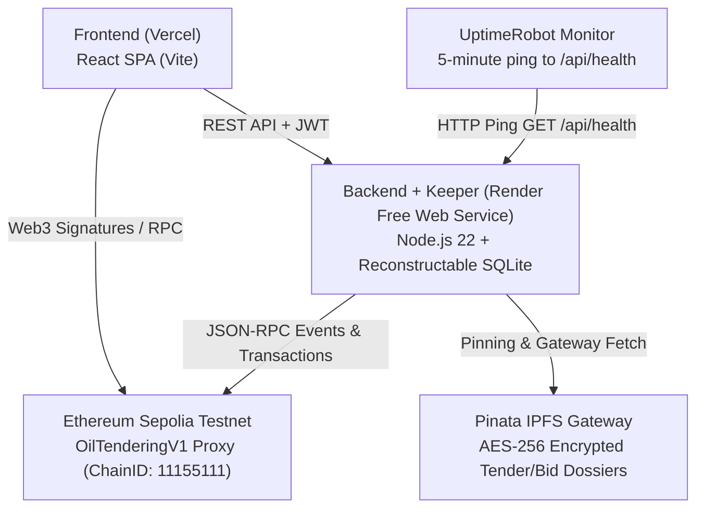

# NIRVAAN Free-Tier Online Deployment Guide

This guide provides step-by-step instructions for deploying NIRVAAN completely on free-tier infrastructure:
- **Smart Contracts**: Ethereum Sepolia Testnet (ERC-1967 Atomic Proxy + Faucet-Conscious 0.01 ETH Dispute Bond)
- **Decentralized Storage**: Pinata Cloud IPFS
- **Backend & Autonomous Keeper**: Render (Single Free Web Service with Ephemeral Reconstructable SQLite)
- **Frontend**: Vercel (Single Page Application with Edge Rewrites)
- **Uptime Monitoring**: UptimeRobot (Free 5-Minute Ping to keep Render service warm)

---

## Architecture Overview



---

## Prerequisites
Before beginning deployment, obtain the following free-tier credentials:
1. **Sepolia Testnet ETH**: Faucet funding for your deployer/officer wallet (e.g. from [Google Cloud Web3 Faucet](https://cloud.google.com/application/web3/faucet/ethereum/sepolia) or [Alchemy Faucet](https://www.alchemy.com/faucets/ethereum-sepolia)).
2. **Sepolia RPC URL**: Free endpoint from [Alchemy](https://www.alchemy.com/), [Infura](https://www.infura.io/), or public RPC (`https://rpc.sepolia.org`).
3. **Pinata Account**: Free account at [Pinata.cloud](https://www.pinata.cloud/) to generate a `PINATA_JWT`.
4. **Render Account**: Free account at [Render.com](https://render.com/).
5. **Vercel Account**: Free account at [Vercel.com](https://vercel.com/).
6. **UptimeRobot Account**: Free account at [UptimeRobot.com](https://uptimerobot.com/).

---

## Step 1: Deploy Smart Contracts on Sepolia

1. Navigate to the `contracts/` directory:
   ```bash
   cd contracts
   npm install
   ```

2. Configure `contracts/.env`:
   ```bash
   cp .env.example .env
   ```
   Populate the following variables:
   - `SEPOLIA_RPC_URL`: Your Sepolia RPC endpoint (e.g. `https://eth-sepolia.g.alchemy.com/v2/YOUR_API_KEY`).
   - `DEPLOYER_PRIVATE_KEY`: Private key of your testnet wallet funded with Sepolia ETH (without `0x` prefix).
   - `ADMIN_MULTISIG_ADDRESS`: Your governance or deployer wallet address.
   - `KEEPER_ADDRESS`: Address of your keeper bot wallet (can be deployer for testnet).
   - `CVC_AUDITOR_ADDRESS`: Address of your CVC vigilance auditor wallet.
   - `TREASURY_ADDRESS`: Address to receive forfeited dispute bonds.
   - `DISPUTE_BOND_ETH`: `0.01` (configured for faucet ETH conservation).
   - `DEFAULT_MIN_EMD_ETH`: `0.001`.
   - `ETHERSCAN_API_KEY`: *(Optional)* Etherscan API key for automated source code verification.

3. Run the automated Sepolia deployment script:
   ```bash
   npm run deploy:sepolia
   ```

4. Verify Output:
   The script deploys the `OilTenderingV1` implementation and `ERC1967Proxy` atomically, verifies the on-chain state, and writes the deployment information to `contracts/deploy/addresses.json`:
   ```json
   {
     "network": "sepolia",
     "chainId": 11155111,
     "proxyAddress": "0xYourDeployedProxyAddress",
     "implementationAddress": "0xYourImplementationAddress",
     "deployBlock": 6842000
   }
   ```
   **Important**: Copy `proxyAddress` and `deployBlock`. You will need them for the backend and frontend configurations.

---

## Step 2: Deploy Backend + Embedded Keeper on Render

Render's free tier provides a free web service without persistent disks or background workers. NIRVAAN is architected so that the SQLite database is ephemeral (`/tmp/nirvaan.db`) and automatically reconstructs the full tender state from blockchain events starting from `DEPLOY_BLOCK` on every boot. The autonomous keeper runs directly inside the backend process.

1. Push your NIRVAAN repository to GitHub (ensure no secrets are committed).
2. Log in to [Render Dashboard](https://dashboard.render.com/) and click **New +** -> **Web Service**.
3. Connect your GitHub repository.
4. Configure the Web Service:
   - **Name**: `nirvaan-backend`
   - **Root Directory**: `backend`
   - **Environment**: `Node`
   - **Build Command**: `npm install`
   - **Start Command**: `npm start`
   - **Plan**: `Free`
   - **Health Check Path**: `/api/health`
5. Under **Environment Variables**, add:
   | Key | Value | Description |
   |---|---|---|
   | `NODE_ENV` | `production` | Production mode |
   | `CHAIN_ID` | `11155111` | Sepolia Chain ID |
   | `SEPOLIA_RPC_URL` | `https://rpc.sepolia.org` | Sepolia JSON-RPC Endpoint |
   | `RPC_URL` | `https://rpc.sepolia.org` | Matching JSON-RPC Endpoint |
   | `CONTRACT_ADDRESS` | `0xYourDeployedProxyAddress` | From Step 1 |
   | `DEPLOY_BLOCK` | `6842000` | Block number from Step 1 |
   | `INDEXER_BATCH_SIZE` | `10` | Log query batch size (default 10; respects Alchemy free-tier limits) |
   | `JWT_SECRET` | *(Random 32+ char string)* | Secure session token secret |
   | `OFFICER_PRIVATE_KEY` | *(64-hex private key)* | Private key for officer backend relay |
   | `KEEPER_PRIVATE_KEY` | *(64-hex private key)* | Private key for embedded keeper wallet |
   | `PINATA_JWT` | *(Your Pinata JWT)* | Pinata API Bearer Token |
   | `PINATA_GATEWAY` | `https://gateway.pinata.cloud/ipfs` | Pinata Gateway URL |
   | `ALLOWED_ORIGINS` | `https://your-frontend.vercel.app` | Your Vercel frontend URL |
   | `DB_PATH` | `/tmp/nirvaan.db` | Ephemeral in-memory/temp SQLite path |
   | `KEEPER_POLL_INTERVAL_S`| `20` | Keeper poll interval (15-30s) |
   | `OFFICER_SEED_JSON` | `[{"username":"iocl_officer","password":"YourPassword123!","psu":"IOCL","officerId":"IOCL-8821","email":"iocl_officer@procurement.gov.in"}]` | Seed credentials |

> [!TIP]
> **RPC Provider Compatibility (Alchemy / Infura / Public RPCs)**:
> Alchemy's free tier limits `eth_getLogs` to 10 blocks. The NIRVAAN indexer defaults `INDEXER_BATCH_SIZE=10`. If an RPC provider returns a "range too large" error, the indexer automatically parses the suggested range or halves the batch size dynamically and immediately retries. If an indexer failure occurs, it will not report false synchronization, keeps retrying in the background every 20 seconds, and reports `indexerLag` and `indexerError` via `/api/health`.

> [!IMPORTANT]
> **Vendor KYC Apply-Then-Approve & Ephemeral Database Lifecycle**:
> 1. **Apply-then-Approve Workflow**: Vendors submit their corporate credentials and IPFS incorporation document via `POST /api/vendors/apply` without requiring an officer JWT. Nodal officers review submissions under `/officer/vendors` and trigger on-chain smart contract registration via `POST /api/vendors/applications/:id/approve`. Public status is queried via `GET /api/vendors/status/:address`.
> 2. **Ephemeral Rebuild & Limitations**: Because Render's free tier uses an ephemeral SQLite database (`/tmp/nirvaan.db`), all `APPROVED` vendors are automatically reconstructed on boot from on-chain `VendorRegistered` events indexed from `DEPLOY_BLOCK`. Any unapproved `PENDING` applications may be cleared on instance reboot; vendors whose applications were pending can simply re-submit credentials if restarted prior to officer approval.

6. Click **Deploy Web Service**.
7. Once deployed, note your Render URL (e.g. `https://nirvaan-backend.onrender.com`).

---

## Step 3: Configure UptimeRobot (Free Health Monitor)

> [!NOTE]
> Render's free tier spins down web services after 15 minutes of inactivity. When a spin-down occurs, the subsequent cold start can take up to 60 seconds while the ephemeral container boots and re-indexes blockchain events.

To prevent spin-down and ensure your embedded keeper runs continuously:
1. Log in to [UptimeRobot](https://uptimerobot.com/).
2. Click **Add New Monitor**.
3. Configure the monitor:
   - **Monitor Type**: `HTTP(s)`
   - **Friendly Name**: `NIRVAAN Backend & Keeper Health`
   - **URL (or IP)**: `https://nirvaan-backend.onrender.com/api/health`
   - **Monitoring Interval**: `Every 5 minutes`
4. Click **Create Monitor**.
5. UptimeRobot will ping `/api/health` every 5 minutes, preventing container sleep and monitoring your indexer lag and keeper status.

---

## Step 4: Deploy Frontend on Vercel

1. Log in to [Vercel](https://vercel.com/) and click **Add New...** -> **Project**.
2. Import your GitHub repository.
3. Configure Project Settings:
   - **Framework Preset**: `Vite`
   - **Root Directory**: `frontend`
   - **Build Command**: `npm run build`
   - **Output Directory**: `dist`
4. Under **Environment Variables**, add:
   | Key | Value |
   |---|---|
   | `VITE_API_URL` | `https://nirvaan-backend.onrender.com` |
   | `VITE_RPC_URL` | `https://rpc.sepolia.org` |
   | `VITE_CONTRACT_ADDRESS` | `0xYourDeployedProxyAddress` |
   | `VITE_CHAIN_ID` | `11155111` |
   | `VITE_ENABLE_DEV_DEMO` | `false` |
5. Click **Deploy**.
6. When deployment finishes, copy your Vercel URL (e.g. `https://nirvaan.vercel.app`) and ensure it is listed in the `ALLOWED_ORIGINS` variable on Render.

---

## Step 5: Verification & End-to-End Smoke Test

Run the automated smoke test suite to verify end-to-end functionality:
```bash
# Set your deployed online URLs
export API_URL="https://nirvaan-backend.onrender.com"
export RPC_URL="https://rpc.sepolia.org"

# Run smoke test
node scripts/smoke-test.js
```

The smoke test automatically verifies:
- Unauthenticated access to `/api/vendors/register`, `/api/vendors/applications`, and `/api/ipfs/upload` is rejected with 401 Unauthorized.
- `/api/health` is online and reporting indexer sync status and keeper health.
- PSU officer login and single-use temporary password change flow.
- Public vendor application submission (`POST /api/vendors/apply`) with status `PENDING`.
- Officer applications register review (`GET /api/vendors/applications`).
- Officer on-chain registration approval (`POST /api/vendors/applications/:id/approve`) transitioning status to `APPROVED`.
- Public KYC status lookup (`GET /api/vendors/status/:address`).
- Tender specification creation (NIT).
- Sealed bid submission with Keccak-256 cryptographic salt commitment.
- Bid opening and salt reveal.
- Technical scoring and lowest-qualified (L1) award determination.

---

## Step 6: Automated Secret Scan Check

Before committing or pushing any code to production, run the secret scanner:
```bash
node scripts/scan-secrets.js
```
The scanner checks every tracked file in the git tree and halts if any 64-hexadecimal private key pattern is present.

---

## Environment Reference Files

Refer to the service `.env.example` templates for complete reference:
- Root: [`.env.example`](file:///home/cybernode/Projects/nirvaan/.env.example)
- Contracts: [`contracts/.env.example`](file:///home/cybernode/Projects/nirvaan/contracts/.env.example)
- Backend: [`backend/.env.example`](file:///home/cybernode/Projects/nirvaan/backend/.env.example)
- Keeper: [`keeper/.env.example`](file:///home/cybernode/Projects/nirvaan/keeper/.env.example)
- Frontend: [`frontend/.env.example`](file:///home/cybernode/Projects/nirvaan/frontend/.env.example)
