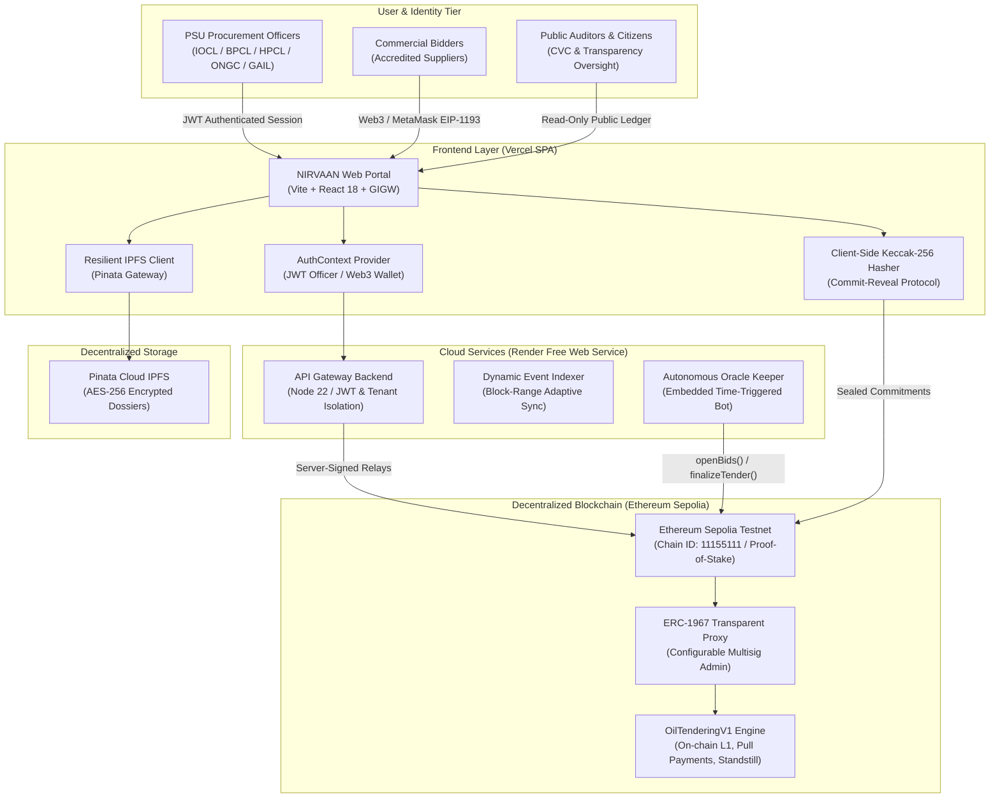
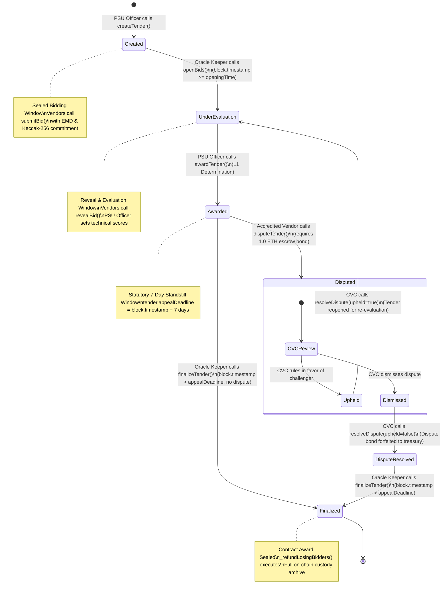

# NIRVAAN: Sovereign Consortium Blockchain E-Tendering Platform

**National Indelible Record & Verification Architecture for Autonomous Negotiation**

NIRVAAN is an enterprise permissioned blockchain e-procurement platform engineered specifically for Indian Public Sector Undertakings (PSUs) operating under the Ministry of Petroleum & Natural Gas, Government of India—including Indian Oil Corporation Limited (IOCL), Bharat Petroleum Corporation Limited (BPCL), Hindustan Petroleum Corporation Limited (HPCL), Oil and Natural Gas Corporation (ONGC), and Gas Authority of India Limited (GAIL).

The platform is designed in strict compliance with the Central Vigilance Commission (CVC) Procurement Guidelines, Sections 3 and 4 of the Information Technology Act, 2000 (electronic records and digital signatures), and the Guidelines for Indian Government Websites (GIGW).

---

## 1. System Architecture Overview



---

## 2. Tender State Machine Lifecycle



---

## 3. Architectural Highlights

- **Decentralized Public Testnet Consensus:** Operates on the Ethereum Sepolia network (Chain ID: 11155111) utilizing Proof-of-Stake consensus, ensuring transparent, immutable, and fully verifiable procurement state execution.
- **Client-Side Commit-Reveal Cryptography:** Commercial financial bids are salted and hashed client-side before broadcast using Solidity `keccak256(vendorAddress, bidAmount, salt, tenderId)`. Bid amounts remain mathematically confidential until the automated public opening phase.
- **Multi-Tenant Sovereign Isolation:** Rigorous tenant and role boundaries prevent cross-tenant data leakage. Procurement officers are restricted exclusively to tenders issued by their respective PSU, with administrative actions inaccessible to vendors and public visitors.
- **Decentralized Specification Dossiers:** Notice Inviting Tender (NIT) specifications, engineering drawings, and evidentiary dossiers are anchored to IPFS via Pinata with cryptographic multihashes verified and stored directly on-chain.
- **Statutory 7-Day Standstill & Configurable Dispute Bond:** Contract awards automatically trigger an immutable 7-day appeal window. Accredited bidders can lodge formal challenges backed by a configurable on-chain escrow bond (0.01 ETH on Sepolia to conserve testnet funds), subject to independent CVC auditor review with 14-day timeout protection.
- **On-Chain L1 Enforcement & Pull Payments:** Smart contract guarantees the awarded winner is strictly the lowest qualified bidder (L1) with matching revealed bid parameters. Push transfers in loops are replaced with pull payments (`withdraw()`), protecting against denial-of-service vulnerabilities.
- **Enterprise Upgradeability:** Smart contracts adhere to the OpenZeppelin ERC-1967 Transparent Upgradeable Proxy Standard, permitting non-disruptive logic upgrades managed by a configurable multi-signature governance key.

---

## 4. Security & Role Authorization Matrix

| Dimension | PSU Procurement Officer | Commercial Bidder (Vendor) | Public Auditor / Citizen |
| :--- | :--- | :--- | :--- |
| **Authentication** | JWT issued via Express Backend; Bcrypt-hashed credentials | Web3 Wallet (MetaMask / Hardware Wallet); On-chain KYC | Unauthenticated (Public Access) |
| **Tender Scope** | Scoped strictly to logged-in PSU (`tender.psu === officerUser.psu`) | All active tenders across all five PSUs | All active tenders across all five PSUs |
| **Bidding Actions** | Prohibited (Bid actions stripped from all officer views) | Submit sealed bid commitments; reveal bids during opening | Read-only; cannot submit bids |
| **Administrative Actions** | Formulate NITs; evaluate revealed bids; execute contract award | None (Protocol 403 access denied) | None |
| **Dispute Filing** | Blocked via Protocol 403 role guard | File dispute with bond within 7-day standstill | None |
| **Award Resolution** | Full Evaluation & Award Console with technical scoring | Read-only public award summary and custody ledger | Read-only public award summary and custody ledger |

---

## 5. Monorepo Repository Structure

```
nirvaan/
├── contracts/                        # Smart Contracts & Testing Suite
│   ├── contracts/
│   │   ├── OilTenderingV1.sol        # Upgradeable Smart Contract Engine (Solidity ^0.8.24)
│   │   └── TenderProxy.sol           # ERC1967Proxy Implementation
│   ├── scripts/
│   │   ├── deploy-sepolia.js         # Atomic Sepolia deployment script
│   │   └── deploy.js                 # Proxy deployment script
│   ├── test/
│   │   └── OilTendering.test.js      # Hardhat test suite (13/13 passing)
│   └── hardhat.config.js             # Hardhat network configuration (Sepolia + local)
│
├── backend/                          # Gateway & Authentication Service
│   ├── server.js                     # Express API server (JWT auth, officer relays, Pinata IPFS)
│   ├── indexer.js                    # Adaptive RPC block-range event indexer
│   ├── embeddedKeeper.js             # Autonomous oracle keeper background worker
│   └── package.json                  # Backend dependencies (Node 22)
│
├── frontend/                         # GIGW-Compliant User Interface
│   ├── src/
│   │   ├── components/               # Accessible UI components & navigation
│   │   ├── pages/                    # Role-gated portal views (Officer, Vendor, CVC, Public)
│   │   └── utils/                    # IPFS, cryptographic, and chain helpers
│   └── package.json                  # Frontend dependencies (React 18 + Vite)
│
└── DEPLOYMENT.md                     # Step-by-step free-tier online deployment guide
```

---

## 6. Deployment & Environment Setup

NIRVAAN is production-ready for free-tier online cloud deployment:
- **Smart Contracts**: Ethereum Sepolia Testnet (ERC-1967 Atomic Proxy)
- **Decentralized Storage**: Pinata Cloud IPFS
- **Backend & Autonomous Keeper**: Render Free Web Service (Node 22 with Ephemeral Reconstructable SQLite)
- **Frontend**: Vercel Single Page Application (Vite SPA)

> For full, beginner-friendly instructions, see [DEPLOYMENT.md](DEPLOYMENT.md).

### Local Test Execution

```bash
# Run all test suites across the monorepo:
npm test

# Run smart contract unit tests (13/13 passing):
npm run test:contracts

# Run backend unit tests & KYC workflows:
npm run test:backend

# Run automated deployment smoke test:
npm run test:smoke

# Security secret scanner (verifies 0 private keys committed):
npm run scan:secrets
```

---

## 7. Verification & Test Suite Summary

The smart contract suite in [`contracts/test/OilTendering.test.js`](contracts/test/OilTendering.test.js) verifies 13 critical operational invariants:

1. **Proxy Initialization & Access Control:** ERC1967Proxy deployment with configurable multisig admin and disabled implementation initializers.
2. **Access Control Enforcement:** Strict permission checks across PSU, Vendor, Keeper, CVC, and Admin roles.
3. **Bid Submission & Deadline:** Rejection of bids submitted after the submission deadline or below minimum EMD.
4. **Duplicate Bid Protection:** Prevention of multiple bids from the same vendor on a single tender.
5. **Bid Reveal & Technical Score:** Cryptographic Keccak-256 reveal verification emitting `BidRevealed`.
6. **Reveal Deadline Enforcement:** Rejection of bid revelations submitted after the reveal window closes.
7. **On-Chain L1 Enforcement:** Guarantee that only the lowest qualified bidder (L1) with matching revealed bid can be awarded.
8. **Dispute Ineligibility:** Rejection of disputes from non-bidders, awarded winners, or below dispute bond.
9. **Dispute UPHELD Resolution:** Winner state reset and dispute bond refunded via pull payments.
10. **Dispute DISMISSED Resolution:** Bond forfeited and transferred directly to treasury address.
11. **14-Day CVC Resolution Timeout:** Automated timeout resolution releasing tenders stalled by inactive auditors.
12. **Finalization & Pull Refunds:** Finalization crediting pull payment refunds to all bidders including the winner.
13. **Tender Cancellation:** Safe tender cancellation returning escrowed EMD to bidders via pull payments.

---

## 8. Regulatory & Compliance Standards

- **Information Technology Act, 2000:** Implements digital signatures and hash commitments compliant with Section 3 (Authentication of electronic records) and Section 4 (Legal recognition of electronic records).
- **Central Vigilance Commission (CVC):** Upholds directives regarding public procurement transparency, mandatory tender publicity periods, post-award standstill windows, and independent grievance redressal.
- **Guidelines for Indian Government Websites (GIGW 3.0):** Incorporates high-contrast accessibility toggles, dynamic text resizing (A-/A/A+), skip-to-content navigation landmarks, and standardized institutional identity banners.
