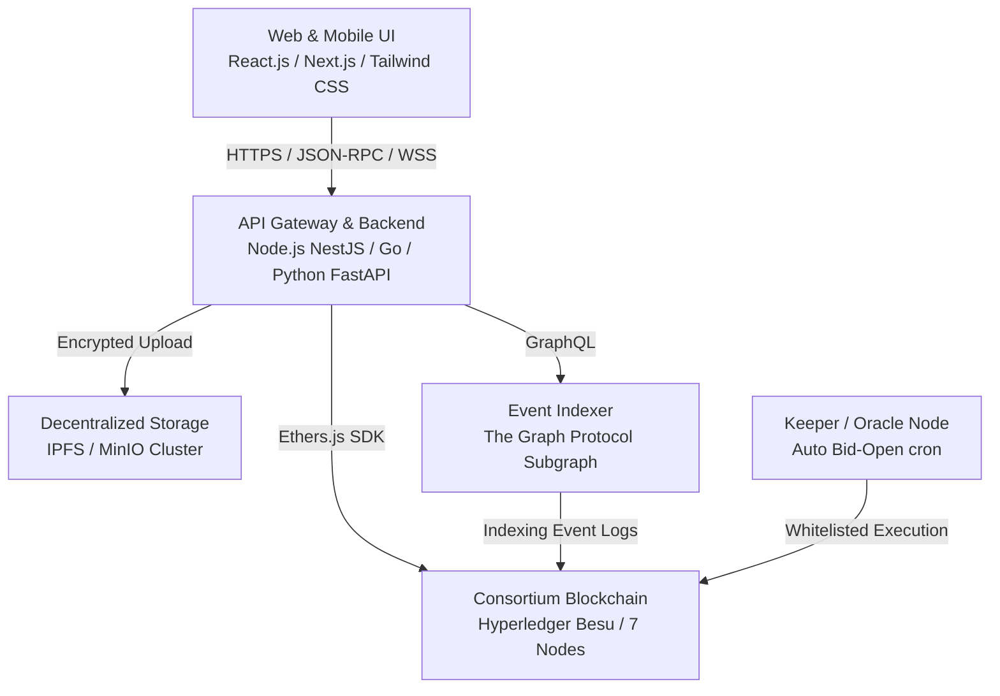
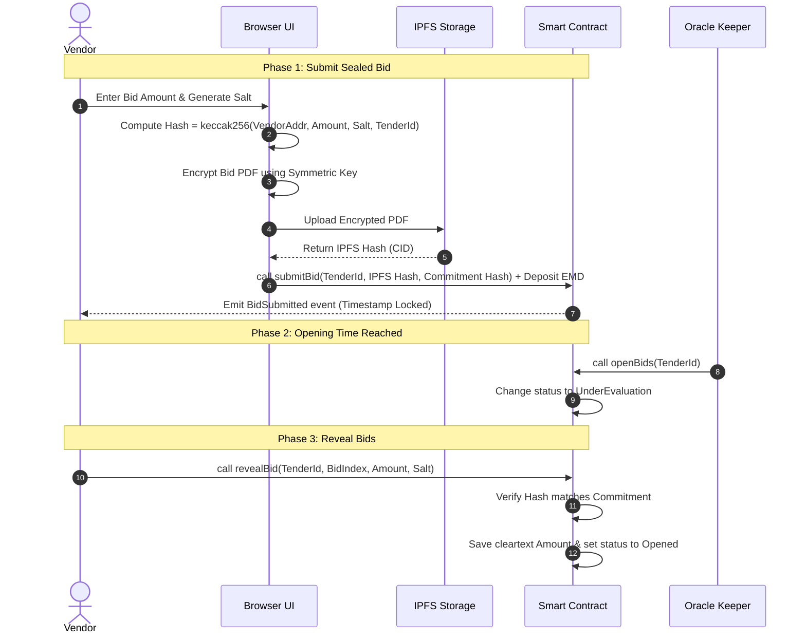
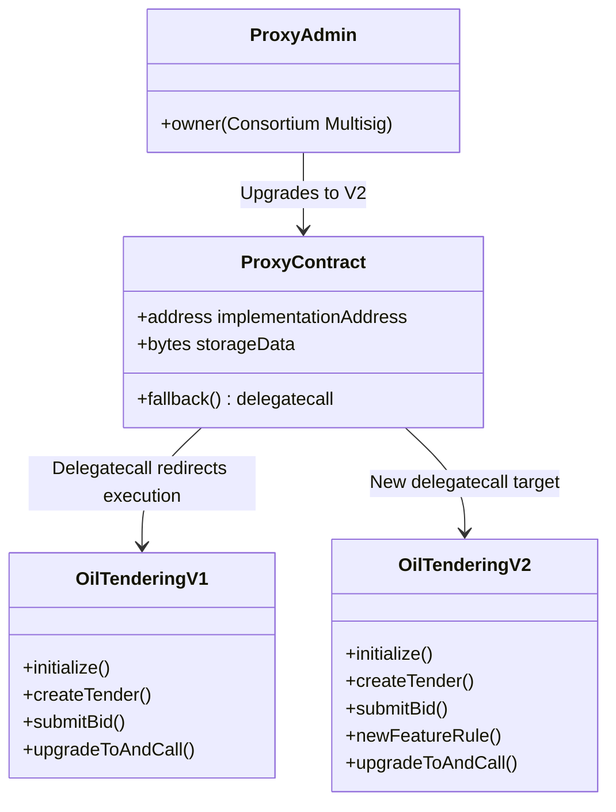

# Comprehensive Architecture & Implementation Report: Blockchain-Enabled Oil E-Tendering System for India

This report outlines the complete technical architecture, cryptographic design, data structures, and implementation roadmap for a secure, transparent, and auditable blockchain-based e-tendering system tailored for Indian Oil PSUs (IOCL, HPCL, BPCL, ONGC, GAIL) and compliant with Central Vigilance Commission (CVC) guidelines and India's IT Act, 2000.

---

## 1. Executive Summary & Problem Statement

The Indian oil and gas sector relies heavily on e-tendering for procurement, logistics, refinery maintenance, and drilling operations. Current centralized e-procurement portals (like GeM or PSU-specific portals) are vulnerable to:
*   **Bid Tampering & Insider Threats:** Potential exposure of financial bids to internal administrators before the official bid-opening time.
*   **Timestamp Disputes:** Disputes over whether a bid was submitted before or after the deadline.
*   **Lack of Immutable Audit Trails:** Difficulty in proving that CVC guidelines (fairness, transparency, non-negotiability) were followed without manual database alterations.
*   **No Integrated Dispute Resolution:** The absence of a formal, on-chain process when a losing bidder challenges the evaluation results.
*   **Rigidity of Smart Contracts:** Inability to patch smart contracts when rules or policies change.

Integrating blockchain technology ensures immutability, cryptographic transparency, automated compliance via Smart Contracts, absolute confidentiality of bid data until the opening window, and a fully auditable dispute resolution trail.

---

## 2. System Architecture & Tech Stack

The solution follows a multi-tier hybrid architecture (On-chain + Off-chain) to handle heavy data (like engineering drawing PDFs, detailed project reports, BOQ documents) efficiently.

### System Architecture Flow Diagram (Mermaid)



---

## 2.1. System Block Diagram & Component Explanations

### System Block Diagram (ASCII Layout)

```
+-----------------------------------------------------------------------------------+
|                                PRESENTATION LAYER                                 |
|  [ React.js / Next.js Web UI ]   <===>   [ Tailwind CSS / Mobile App Dashboard ]  |
+----------------------------------------+------------------------------------------+
                                         | (JSON-RPC, REST API, WebSockets)
                                         v
+-----------------------------------------------------------------------------------+
|                                APPLICATION LAYER                                  |
|   [ NestJS API Gateway ]   <===>   [ Key Management Service (HashiCorp Vault) ]   |
+-------------------+--------------------+--------------------+---------------------+
                    |                    |                    |
      (Ethers.js)   |       (IPFS API)   |      (GraphQL)     | (JSON-RPC)
                    v                    v                    v
+-------------------+---+  +-------------+-------+  +---------+---------+  +--------+
|  BLOCKCHAIN LAYER     |  |   DECENTRALIZED     |  | EVENT INDEXER     |  | ORACLE |
|  [ Hyperledger Besu ] |  |   STORAGE           |  | [ The Graph ]     |  | KEEPER |
|  - QBFT Consensus     |  |  [ IPFS / MinIO ]   |  | - Subgraph DB     |  | - Cron |
|  - Smart Contracts    |  |  - Encrypted Bids   |  | - GraphQL API     |  | - Auto |
|  - State Database     |  |  - Tender PDFs      |  |   Queries         |  |   Open |
+-----------------------+  +---------------------+  +-------------------+  +--------+
```

### Detailed Component Explanations

#### 1. Presentation Layer (Web & Mobile UI)
*   **Role:** The frontend interface accessed by PSU administrators and bidding vendors.
*   **Key Responsibilities:**
    *   **PSU Workspace:** Creating and publishing tenders, reviewing vendor list status, scoring technical evaluations, and viewing final rankings.
    *   **Vendor Workspace:** Viewing active tenders, generating cryptographic keypairs, performing client-side encryption of bid documentation, submitting EMDs, and initiating disputes.
    *   **Client-Side Cryptography:** Generates the symmetric encryption key and computes the commitment hash (`keccak256`) in the browser using WebAssembly. This ensures the raw bid amount is never sent across the network in cleartext.

#### 2. Application Layer (API Gateway & Middleware)
*   **Role:** The secure broker managing identity, business logic, and transaction signing.
*   **Key Responsibilities:**
    *   **Authentication & KYC Bridge:** Queries external government APIs (GSTIN, MCA21, PAN) to verify vendor identities before allowing onboarding.
    *   **Key Management System (KMS):** Interfaces with HSMs (Hardware Security Modules) to manage administrative private keys for the PSUs.
    *   **Integration Layer:** Integrates with PSU SAP/ERP systems and banking channels for automatic PO generation and EMD escrow reconciliation.

#### 3. Decentralized Storage Block (IPFS & MinIO)
*   **Role:** Handles high-volume, unstructured storage off-chain.
*   **Key Responsibilities:**
    *   **Tender Specifications:** Stores heavy PSU files (engineering drawings, specifications PDFs).
    *   **Encrypted Bid Envelopes:** Stores the encrypted vendor proposals. Since files are encrypted *before* uploading, the storage providers cannot inspect the content.
    *   **Hash Anchoring:** Returns unique, content-addressable hashes (IPFS CIDs) which are stored on-chain. This guarantees file immutability (changing 1 byte of the PDF changes the CID hash completely).

#### 4. Blockchain Layer (Hyperledger Besu Consortium)
*   **Role:** The single source of truth and state verification machine.
*   **Key Responsibilities:**
    *   **Smart Contracts:** Runs Solidity programs that enforce the tendering rules (deadlines, qualifications, disputes).
    *   **Immutable Timestamping:** Records the exact block time of transaction submission, eliminating timestamp falsification disputes.
    *   **State Database:** Holds current registry states (whitelisted vendors, active tenders, bid commitments).

#### 5. Event Indexer Block (The Graph Protocol)
*   **Role:** Speeds up frontend data retrieval and query execution.
*   **Key Responsibilities:**
    *   **Event Scraping:** Monitors the blockchain block-by-block, parsing contract events (`TenderCreated`, `BidSubmitted`, `TenderAwarded`).
    *   **Relational Querying:** Converts unstructured log receipts into an off-chain SQL-style database.
    *   **Performance Optimization:** Serves queries like *"List all bids submitted by Vendor X"* or *"Show sorted bid amounts for Tender Y"* via standard GraphQL APIs within milliseconds, bypasses slow direct RPC loops.

#### 6. Oracle Keeper Block (Automated Execution Node)
*   **Role:** Automates contract execution based on time triggers.
*   **Key Responsibilities:**
    *   **Automated Transitioning:** Continuously checks block timestamps against tender submission and opening deadlines.
    *   **Whitelisted Calls:** Automatically signs and executes `openBids()` and `finalizeTender()` transactions when deadlines pass. This removes human dependency and bias from structural phase transitions.

---

## 3. Blockchain Network Type & Consensus Algorithm

### Network Type: Consortium (Permissioned) Blockchain
A **Consortium Blockchain** is operated by a pre-selected set of trusted nodes hosted by key Indian oil sector stakeholders.

*   **Why NOT Public?** Public networks (Ethereum, Solana) expose trade-sensitive details, have volatile gas fees, and violate national data sovereignty requirements.
*   **Validator Nodes (7 Nodes Recommended):**
    1.  Ministry of Petroleum and Natural Gas (MoPNG)
    2.  IOCL (Indian Oil Corporation Limited)
    3.  BPCL (Bharat Petroleum Corporation Limited)
    4.  HPCL (Hindustan Petroleum Corporation Limited)
    5.  ONGC (Oil and Natural Gas Corporation)
    6.  GAIL (Gas Authority of India Limited)
    7.  NIC (National Informatics Centre) - Infrastructure Node
*   **Auditor Nodes (Read-only):** Central Vigilance Commission (CVC) and MeitY.
*   **Users (Clients):** Registered vendors and bidders.

### Consensus Algorithm: QBFT / IBFT 2.0 (Istanbul Byzantine Fault Tolerance)
The IBFT 2.0 consensus algorithm requires a minimum of $(3f + 1)$ nodes to tolerate $f$ Byzantine (malicious or failed) nodes.
*   **Why 7 Nodes?** With 4 nodes, the network can only tolerate 1 failure. If a single PSU node goes offline, the network halts. A 7-node system tolerates **2 simultaneous node failures**, providing the safety margin needed for critical national infrastructure.
*   **Immediate Finality:** Blocks cannot be forked, ensuring that bid timestamps are legally binding and indisputable.
*   **Zero Gas Fees:** Explicitly set `"gasPrice": "0x0"` in the Besu `genesis.json` configuration, removing transaction costs for both PSUs and vendors.

---

## 4. Cryptographic Core Workflows

### A. Commit-Reveal Scheme for Bid Confidentiality
To prevent front-running or bid leakage, vendors submit a commitment hash instead of the cleartext bid.



*   **Replay Prevention:** The commitment is computed as `keccak256(abi.encodePacked(vendorAddress, bidAmount, salt, tenderId))`. Including the `vendorAddress` and `tenderId` prevents copy-paste submissions from other vendors or cross-tender replay attacks.

---

## 5. Dispute Resolution Flow

When a PSU awards a tender, losing bidders have a **7-day appeal window** to file a formal dispute on-chain.

```mermaid
stateDiagram-v2
    [*] --> UnderEvaluation
    UnderEvaluation --> Awarded : PSU calls awardTender()
    
    state Awarded {
        [*] --> AppealWindowActive : 7-Day timer starts
    }
    
    AppealWindowActive --> Disputed : Losing bidder calls disputeTender() + Deposits Bond
    AppealWindowActive --> Finalized : Timer expires (Keeper calls finalizeTender())
    
    state Disputed {
        [*] --> CVCReview : CVC Auditor notified
        CVCReview --> Upheld : CVC rules in favor of bidder
        CVCReview --> Dismissed : CVC rules in favor of PSU
    }

    Upheld --> UnderEvaluation : Reset evaluation & refund dispute bond
    Dismissed --> DisputeResolved : Forfeit dispute bond to PSU
    DisputeResolved --> Finalized : Keeper finalizes tender
    Finalized --> [*] : EMD refunded to losers; PO generated in SAP
```



---

## 6. Smart Contract Upgrade Pattern: UUPS Proxy

To allow contract upgrades (e.g., changes in CVC guidelines) without deleting historical tender data, we separate logic and storage using the **UUPS (Universal Upgradeable Proxy Standard)** pattern.



---

## 7. Complete Smart Contract Implementation

Below is the complete, compilable Solidity implementation for `OilTenderingV1`. It incorporates the initialization pattern, Oracle/Keeper automated triggers, dispute states, vendor KYC binding, and re-entrancy protections.

```solidity
// SPDX-License-Identifier: MIT
pragma solidity ^0.8.20;

import "@openzeppelin/contracts-upgradeable/proxy/utils/Initializable.sol";
import "@openzeppelin/contracts-upgradeable/proxy/utils/UUPSUpgradeable.sol";

contract OilTenderingV1 is Initializable, UUPSUpgradeable {

    // -----------------------------------------------------------------------
    // ENUMS
    // -----------------------------------------------------------------------

    enum TenderStatus {
        Created,
        Active,
        Closed,
        UnderEvaluation,
        Awarded,           // 7-day appeal window active
        Disputed,          // Formal challenge filed
        DisputeResolved,   // CVC has ruled
        Finalized,         // Ready for contract execution
        Cancelled
    }

    enum BidStatus { Submitted, Opened, Accepted, Rejected }

    // -----------------------------------------------------------------------
    // STRUCTS
    // -----------------------------------------------------------------------

    struct Tender {
        uint256 id;
        address psuAddress;
        string ipfsHashDoc;           // SHA-256 hash of tender doc on IPFS
        uint256 submissionDeadline;   // Unix timestamp
        uint256 openingTime;          // Unix timestamp
        uint256 appealDeadline;       // Set when tender is awarded (awardedTime + 7 days)
        uint256 minEMDAmount;         // Earnest Money Deposit
        TenderStatus status;
        address winner;
        uint256 winningBidId;
        uint256 winningBidAmount;
    }

    struct Bid {
        uint256 id;
        uint256 tenderId;
        address vendorAddress;
        string encryptedBidIpfsHash;  // Encrypted bid file on IPFS
        bytes32 bidCommitment;        // keccak256(vendor+amount+salt+tenderId)
        uint256 submissionTime;       // Automatically set by block.timestamp
        uint256 bidAmount;            // Revealed during opening phase
        BidStatus status;
        bool isTechQualified;
        uint256 techScore;
        uint256 emdDeposited;         // Exact EMD amount sent by vendor
    }

    struct VendorKYC {
        bytes32 gstinHash;
        bytes32 panHash;
        string kycIpfsHash;
        uint256 registeredAt;
        bool isActive;
    }

    struct Dispute {
        uint256 tenderId;
        address challenger;
        string reasonIpfsHash;
        uint256 filedAt;
        bool isResolved;
        bool isUpheld;
        string cvcReasonIpfsHash;
        uint256 disputeBondDeposited; // Holds the exact refund amount
    }

    // -----------------------------------------------------------------------
    // STORAGE MAPPINGS
    // -----------------------------------------------------------------------

    mapping(uint256 => Tender) public tenders;
    mapping(uint256 => Bid[]) public tenderBids;
    mapping(address => bool) public registeredPSUs;
    mapping(address => bool) public registeredVendors;
    mapping(address => VendorKYC) public vendorKYC;
    mapping(uint256 => Dispute) public tenderDisputes;

    uint256 public tenderCounter;
    uint256 public bidCounter;

    address public keeperAddress;     // Whitelisted Keeper/Oracle wallet
    address public cvcAuditorAddress; // CVC read/resolve address
    address public multisigAdmin;     // Consortium multisig for upgrades

    // -----------------------------------------------------------------------
    // EVENTS (for Subgraph indexing)
    // -----------------------------------------------------------------------

    event TenderCreated(uint256 indexed tenderId, address indexed psu, uint256 deadline);
    event BidSubmitted(uint256 indexed tenderId, uint256 indexed bidId, address indexed vendor);
    event BidsOpened(uint256 indexed tenderId);
    event TenderAwarded(uint256 indexed tenderId, address indexed winner, uint256 amount);
    event DisputeFiled(uint256 indexed tenderId, address indexed challenger);
    event DisputeResolved(uint256 indexed tenderId, bool upheld);
    event TenderFinalized(uint256 indexed tenderId);
    event VendorRegistered(address indexed vendor, bytes32 gstinHash, uint256 timestamp);

    // -----------------------------------------------------------------------
    // MODIFIERS
    // -----------------------------------------------------------------------

    modifier onlyPSU() {
        require(registeredPSUs[msg.sender], "Only registered PSUs allowed");
        _;
    }

    modifier onlyVendor() {
        require(registeredVendors[msg.sender], "Only registered Vendors");
        _;
    }

    modifier onlyKeeper() {
        require(msg.sender == keeperAddress, "Only keeper allowed");
        _;
    }

    modifier onlyCVC() {
        require(msg.sender == cvcAuditorAddress, "Only CVC auditor allowed");
        _;
    }

    modifier onlyAdmin() {
        require(msg.sender == multisigAdmin, "Only admin allowed");
        _;
    }

    // -----------------------------------------------------------------------
    // UUPS INITIALIZATION (Replaces Constructor)
    // -----------------------------------------------------------------------

    /// @custom:oz-upgrades-unsafe-allow constructor
    constructor() {
        _disableInitializers();
    }

    function initialize(
        address _multisigAdmin,
        address _keeperAddress,
        address _cvcAuditorAddress
    ) public initializer {
        multisigAdmin = _multisigAdmin;
        keeperAddress = _keeperAddress;
        cvcAuditorAddress = _cvcAuditorAddress;
        
        __UUPSUpgradeable_init();
    }

    // -----------------------------------------------------------------------
    // CORE FUNCTIONS
    // -----------------------------------------------------------------------

    function createTender(
        string memory _ipfsHash,
        uint256 _submissionDeadline,
        uint256 _openingTime,
        uint256 _minEMD
    ) external onlyPSU {
        require(_submissionDeadline > block.timestamp, "Deadline must be in the future");
        require(_openingTime >= _submissionDeadline, "Opening must be after deadline");

        tenderCounter++;
        tenders[tenderCounter] = Tender({
            id: tenderCounter,
            psuAddress: msg.sender,
            ipfsHashDoc: _ipfsHash,
            submissionDeadline: _submissionDeadline,
            openingTime: _openingTime,
            appealDeadline: 0, // Set later during award
            minEMDAmount: _minEMD,
            status: TenderStatus.Created,
            winner: address(0),
            winningBidId: 0,
            winningBidAmount: 0
        });

        emit TenderCreated(tenderCounter, msg.sender, _submissionDeadline);
    }

    function submitBid(
        uint256 _tenderId,
        string memory _encryptedBidIpfs,
        bytes32 _bidCommitment
    ) external payable onlyVendor {
        Tender storage tender = tenders[_tenderId];
        require(block.timestamp < tender.submissionDeadline, "Submission period over");
        require(msg.value >= tender.minEMDAmount, "Insufficient EMD amount");

        bidCounter++;
        tenderBids[_tenderId].push(Bid({
            id: bidCounter,
            tenderId: _tenderId,
            vendorAddress: msg.sender,
            encryptedBidIpfsHash: _encryptedBidIpfs,
            bidCommitment: _bidCommitment,
            submissionTime: block.timestamp,
            bidAmount: 0,
            status: BidStatus.Submitted,
            isTechQualified: false,
            techScore: 0,
            emdDeposited: msg.value
        }));

        emit BidSubmitted(_tenderId, bidCounter, msg.sender);
    }

    // Keeper calls this to open the bid evaluation process
    function openBids(uint256 _tenderId) external onlyKeeper {
        Tender storage tender = tenders[_tenderId];
        require(block.timestamp >= tender.openingTime, "Opening time not reached");
        require(tender.status == TenderStatus.Created, "Tender not in Created state");

        tender.status = TenderStatus.UnderEvaluation;
        emit BidsOpened(_tenderId);
    }

    function revealBid(
        uint256 _tenderId,
        uint256 _bidIndex,
        uint256 _bidAmount,
        bytes32 _salt
    ) external onlyVendor {
        Tender storage tender = tenders[_tenderId];
        require(tender.status == TenderStatus.UnderEvaluation, "Bids not yet opened");

        Bid storage bid = tenderBids[_tenderId][_bidIndex];
        require(bid.vendorAddress == msg.sender, "Not your bid");

        bytes32 computedCommitment = keccak256(
            abi.encodePacked(msg.sender, _bidAmount, _salt, _tenderId)
        );
        require(computedCommitment == bid.bidCommitment, "Commitment mismatch -- tampering detected");

        bid.bidAmount = _bidAmount;
        bid.status = BidStatus.Opened;
    }

    // Allow PSU Evaluators to set technical qualifications
    function setTechnicalScore(
        uint256 _tenderId,
        uint256 _bidIndex,
        bool _qualified,
        uint256 _score
    ) external onlyPSU {
        Tender storage tender = tenders[_tenderId];
        require(tender.psuAddress == msg.sender, "Only issuing PSU allowed");
        require(tender.status == TenderStatus.UnderEvaluation, "Tender not under evaluation");

        Bid storage bid = tenderBids[_tenderId][_bidIndex];
        bid.isTechQualified = _qualified;
        bid.techScore = _score;
    }

    // PSU awards the tender to the qualified L1 bidder
    function awardTender(
        uint256 _tenderId,
        address _winner,
        uint256 _winningBidId,
        uint256 _winningBidAmount
    ) external onlyPSU {
        Tender storage tender = tenders[_tenderId];
        require(tender.psuAddress == msg.sender, "Only issuing PSU allowed");
        require(tender.status == TenderStatus.UnderEvaluation, "Tender not under evaluation");

        tender.winner = _winner;
        tender.winningBidId = _winningBidId;
        tender.winningBidAmount = _winningBidAmount;
        tender.status = TenderStatus.Awarded;
        
        // Start 7-day appeal window
        tender.appealDeadline = block.timestamp + 7 days;

        emit TenderAwarded(_tenderId, _winner, _winningBidAmount);
    }

    function disputeTender(
        uint256 _tenderId,
        string memory _reasonIpfsHash
    ) external payable onlyVendor {
        Tender storage tender = tenders[_tenderId];
        require(tender.status == TenderStatus.Awarded, "Tender not in Awarded state");
        require(block.timestamp <= tender.appealDeadline, "Appeal window has closed");
        require(msg.value >= 10000 ether, "Dispute bond required"); // 10000 base tokens

        tenderDisputes[_tenderId] = Dispute({
            tenderId: _tenderId,
            challenger: msg.sender,
            reasonIpfsHash: _reasonIpfsHash,
            filedAt: block.timestamp,
            isResolved: false,
            isUpheld: false,
            cvcReasonIpfsHash: "",
            disputeBondDeposited: msg.value
        });

        tender.status = TenderStatus.Disputed;
        emit DisputeFiled(_tenderId, msg.sender);
    }

    function resolveDispute(
        uint256 _tenderId,
        bool _upheld,
        string memory _cvcReasonIpfsHash
    ) external onlyCVC {
        Tender storage tender = tenders[_tenderId];
        require(tender.status == TenderStatus.Disputed, "No active dispute");

        Dispute storage dispute = tenderDisputes[_tenderId];
        dispute.isResolved = true;
        dispute.isUpheld = _upheld;
        dispute.cvcReasonIpfsHash = _cvcReasonIpfsHash;

        uint256 refundAmount = dispute.disputeBondDeposited;
        dispute.disputeBondDeposited = 0; // Re-entrancy protection

        if (_upheld) {
            tender.status = TenderStatus.UnderEvaluation;
            payable(dispute.challenger).transfer(refundAmount);
        } else {
            tender.status = TenderStatus.DisputeResolved;
            payable(tender.psuAddress).transfer(refundAmount);
        }

        emit DisputeResolved(_tenderId, _upheld);
    }

    function registerVendor(
        address _vendorAddress,
        bytes32 _gstinHash,
        bytes32 _panHash,
        string memory _kycIpfsHash
    ) external onlyAdmin {
        require(!registeredVendors[_vendorAddress], "Already registered");
        vendorKYC[_vendorAddress] = VendorKYC({
            gstinHash: _gstinHash,
            panHash: _panHash,
            kycIpfsHash: _kycIpfsHash,
            registeredAt: block.timestamp,
            isActive: true
        });
        registeredVendors[_vendorAddress] = true;
        emit VendorRegistered(_vendorAddress, _gstinHash, block.timestamp);
    }

    // Keeper calls this to auto-finalize if no dispute is filed within 7 days
    function finalizeTender(uint256 _tenderId) external onlyKeeper {
        Tender storage tender = tenders[_tenderId];
        require(tender.status == TenderStatus.Awarded, "Not in Awarded state");
        require(block.timestamp > tender.appealDeadline, "Appeal window still open");

        tender.status = TenderStatus.Finalized;
        _refundLosingBidders(_tenderId);
        emit TenderFinalized(_tenderId);
    }

    // Secure pull/push EMD refund structure with re-entrancy prevention
    function _refundLosingBidders(uint256 _tenderId) internal {
        Bid[] storage bids = tenderBids[_tenderId];
        Tender storage tender = tenders[_tenderId];
        for (uint256 i = 0; i < bids.length; i++) {
            if (bids[i].vendorAddress != tender.winner && bids[i].emdDeposited > 0) {
                uint256 refund = bids[i].emdDeposited;
                bids[i].emdDeposited = 0; // Set to zero before transfer to prevent re-entrancy
                payable(bids[i].vendorAddress).transfer(refund);
            }
        }
    }

    function _authorizeUpgrade(address) internal override onlyAdmin {}
}
```

---

## 8. Hashing, Encoding & Key Management Standards

To maintain standardizations for Indian government audits:

| Parameter | Standard / Protocol | Purpose |
| :--- | :--- | :--- |
| **File Integrity** | SHA-256 | Ensures tender specs and submitted bid documents are untampered on IPFS. |
| **On-Chain Commits** | Keccak-256 | Used for the bidding commitment hash and block transaction receipts. |
| **IPFS Off-chain URIs** | Base58 (CIDv1) | Addressing mechanism for storing documents off-chain. |
| **Indian Legal Validity** | Class-3 DSC (X.509/DER) | Integrates hardware USB tokens (ePass2003) for vendor PKI signature checks. |
| **PSU Administrative Authorization** | Gnosis Safe Multisig | Multi-signature transactions requiring 2-out-of-3 PSU officer approvals. |
| **Node Wallet Encryption** | HashiCorp Vault / Cloud HSM | Protects the validator nodes' consensus keys and the Oracle keeper's wallet. |

---

## 9. Implementation Roadmap

### Step 1: Sandbox & Genesis block Configuration (Months 1-2)
*   Initialize 7 Hyperledger Besu nodes on private VMs. Set up QBFT consensus.
*   Write `genesis.json` with `"gasPrice": "0x0"`.
*   Deploy UUPS proxy smart contracts. Configure off-chain IPFS storage nodes.

### Step 2: PKI & KMS Integration (Months 3-4)
*   Integrate standard DSC libraries to sign transaction hashes client-side.
*   Setup HashiCorp Vault transit secrets engine for automatic transaction signing by the middleware.
*   Configure the Oracle Keeper backend to continuously poll the network.

### Step 3: Web Portal, KYC & Subgraph Indexer (Months 5-6)
*   Develop React.js dashboards for PSUs and vendors.
*   Integrate API check validations for GSTIN, MCA21, and PAN.
*   Write and deploy The Graph subgraph schemas to index network events.

### Step 4: Audit & CVC Pilot (Months 7-8)
*   Initiate smart contract security audits via CERT-In-certified auditors.
*   Onboard the CVC to audit transaction logs via their dedicated auditor node.
*   Execute a test tender with IOCL's pipeline division.

### Step 5: Full Rollout & SAP Integration (Months 9-12)
*   Connect the middleware event listeners to PSU SAP/ERP endpoints to auto-generate POs upon tender finalization.
*   Promote nodes to production data centers.
